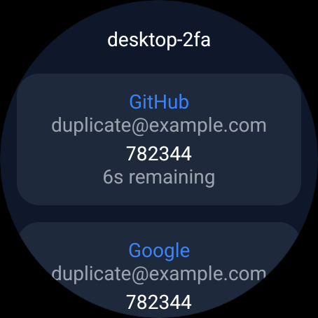
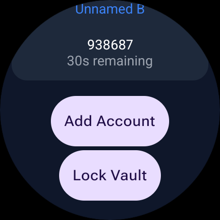
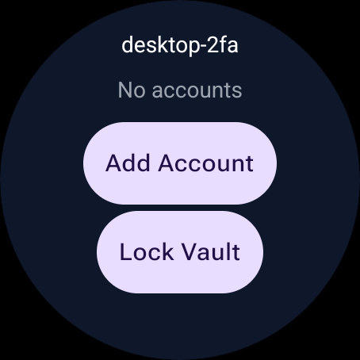
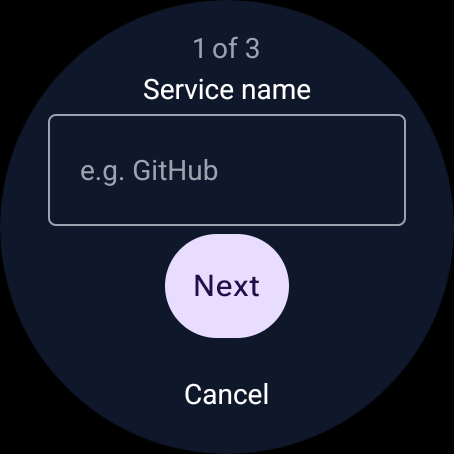
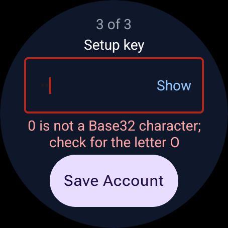
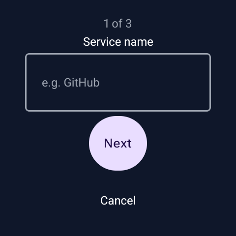
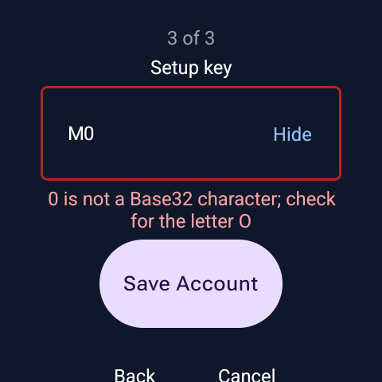
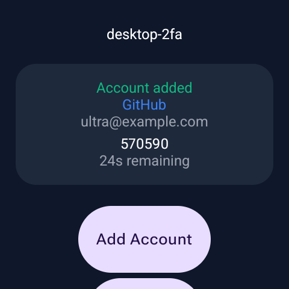

# 🛡️ Desktop-2FA for Wear OS

An offline TOTP authenticator for your wrist. Built with Kotlin and Jetpack
Compose for Wear OS, with a local encrypted vault designed around the
[Desktop-2FA](https://github.com/wrogistefan/desktop-2fa) file format.

🌐 **Project website:** [desktop-2fa.org](https://desktop-2fa.org/)


[](LICENSE)
[](https://github.com/wrogistefan/desktop-2fa-watch/actions)

The **v0.2.0** tag marks the standalone MVP: creating a vault, adding accounts
manually, viewing live codes, and locking the vault. Current development adds
guided account setup. Watch import/export and synchronization are not available yet.

---

## ✨ Features

| Feature | Description |
|---------|-------------|
| 🔐 **Vault Security** | AES-256-GCM encryption with Argon2id key derivation |
| ⏱️ **Live TOTP Codes** | Account cards with codes and countdowns refreshed every second |
| ⌚ **Wear OS Interface** | Native scrolling list with rounded account cards |
| ➕ **Manual Account Setup** | Three-step wizard with one field per screen, secret visibility, and Base32 validation |
| 🔓 **Optional Password Storage** | Remember the password using encrypted preferences protected by Android Keystore |
| 🔒 **Manual Lock** | Leave the account view and request removal of the remembered password |
| 📴 **Offline Operation** | No registration, cloud service, or phone companion required |
| 📁 **Versioned Vault** | `.d2fa` v1 layout and cryptographic parameters match the desktop implementation |

New accounts use SHA1, 6 digits, and a 30-second period. The model and generator
also support SHA256/SHA512 and other account parameters; the current form does
not expose those settings.

---

## 📸 Screenshots

### Wear OS emulator

Captured from the Large Round Wear OS emulator (454 × 454), using synthetic
accounts. Duplicate names are intentional regression-test data. These are
actual application screenshots, not mockups or physical-device results.

| Live accounts | Vault actions | Empty vault |
|:-------------:|:-------------:|:-----------:|
|  |  |  |

The development version adds a guided, one-field-per-screen setup:

| Account wizard | Setup key feedback |
|:--------------:|:------------------:|
|  |  |

### Galaxy Watch Ultra

The wizard was also checked on a physical Galaxy Watch Ultra (SM-L705F).
See the [device report](docs/testing/galaxy-watch-ultra.md) for test results,
more screenshots, and the Samsung fullscreen-keyboard limitation.

| Single-field setup | Validation | Account added |
|:------------------:|:----------:|:-------------:|
|  |  |  |

---

## 🚀 Quick Start

### Build and install

Open this repository in Android Studio with Android SDK Platform 37 installed.
The Gradle wrapper uses a Java 25 daemon toolchain configured in the repository.
See the [development guide](docs/development.md) for prerequisites and device setup.

```bash
./gradlew assembleDebug
adb -s <device-serial> install -r app/build/outputs/apk/debug/app-debug.apk
```

On Windows PowerShell, use `.\gradlew.bat assembleDebug`. Install `adb` through
Android SDK Platform-Tools, or run the app directly from Android Studio.

### First use

1. Open **desktop-2fa for Wear OS** and create a vault with a strong password.
2. Choose whether to enable **Remember on watch** (enabled by default).
3. Tap **Add Account** and follow three steps: service name, account name,
   and setup key. Each step has one field, with Back and Cancel actions.
4. Read the current code and countdown from the account card.
5. Scroll to **Lock Vault** when finished.

The app does not currently scan QR codes or accept `otpauth://` links. Keep your
service recovery codes: the MVP has no user-facing vault backup or export flow.
The [user manual](docs/user_manual.md) covers setup, storage, and troubleshooting.

---

## 📁 Vault Lifecycle & Desktop Compatibility

The watch keeps `vault.d2fa` in its private application files directory. The
file uses the desktop v1 header, Argon2id parameters, AES-GCM layout, and JSON
field names. Normal app updates with the same application ID and signing key
retain app data; uninstalling or clearing storage removes it.

**Shared format does not yet mean a supported transfer workflow.** Automated
Python ↔ Kotlin round trips, aligned validation, and encrypted watch
import/export are tracked in [issue #10](https://github.com/wrogistefan/desktop-2fa-watch/issues/10).
See the [compatibility assessment](docs/compatibility.md) for current boundaries.

---

## 🔒 Security

- **AES-256-GCM** authenticates and encrypts the vault payload.
- **Argon2id** derives the key with 4 iterations, 128 MiB memory, and parallelism 2.
- **Android Keystore** protects the encrypted preferences used by the optional
  password cache. The vault itself remains password encrypted.
- **Backup exclusions** cover the vault and credential preferences in the
  configured Android cloud-backup and device-transfer rules.

The watch password-strength check is a local character/length heuristic, not
the desktop app's zxcvbn evaluation. Unlock sessions are held in memory; there
is no automatic inactivity lock or device-authentication prompt for cached
password use. See the [security model](docs/SECURITY.md) for limitations.

---

## 📚 Documentation

| Document | Description |
|----------|-------------|
| [User Manual](docs/user_manual.md) | Setup, account entry, locking, and troubleshooting |
| [Security Model](docs/SECURITY.md) | Trust boundaries, password caching, and data-loss risks |
| [Cryptography](docs/crypto.md) | Vault layout, parameters, and persistence behavior |
| [Watch UX](docs/ux.md) | Screen behavior and MVP boundaries |
| [Desktop Compatibility](docs/compatibility.md) | Source-level parity and planned import/export |
| [Development](docs/development.md) | Build, tests, emulator, and physical-device checks |
| [UI Test Reports](docs/testing/README.md) | Emulator and Galaxy Watch Ultra results, screenshots, and limitations |
| [Changelog](CHANGELOG.md) | Version history |
| [Security Reporting](SECURITY.md) | Private vulnerability disclosure |

---

## 🧪 Testing

```bash
./gradlew testDebugUnitTest
./gradlew assembleDebug
```

The unit suite covers vault round trips, wrong passwords, unsupported payload
versions, password strength, and wizard validation, navigation, and save guards. Manual emulator
checks cover duplicate/unnamed entries, scrolling, live codes, the empty state,
opening the add-account form, and manual lock. The account wizard has also been
checked on a physical Galaxy Watch Ultra; see the device report above for the
scope and remaining keyboard limitation. Automated interoperability tests remain outstanding.

---

## 🏗️ Project Structure

```text
app/src/main/java/org/desktop2fa/desktop/watch/
├── model/          # Serializable vault and TOTP entry models
├── presentation/   # Compose screens and theme
└── vault/          # Encryption, persistence, credential cache, and TOTP

app/src/test/       # JVM unit tests
assets/screenshots/ # Emulator captures with synthetic accounts
docs/               # User and developer documentation
```

---

## 📄 License

GNU General Public License v3.0. See [LICENSE](LICENSE).

## 👤 Author & Contact

Łukasz Perek · [contact@desktop-2fa.org](mailto:contact@desktop-2fa.org)

Report bugs and feature requests through
[GitHub Issues](https://github.com/wrogistefan/desktop-2fa-watch/issues).
For vulnerabilities, follow [Security Reporting](SECURITY.md).
