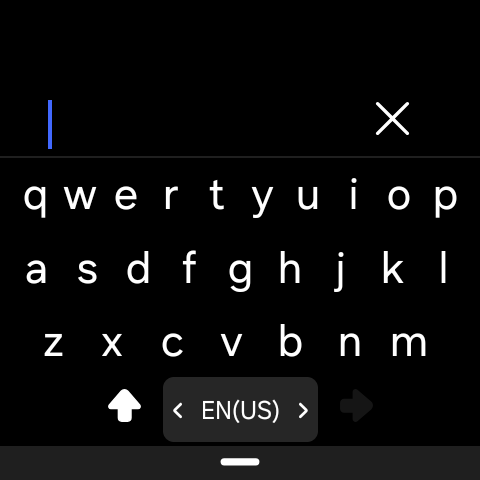
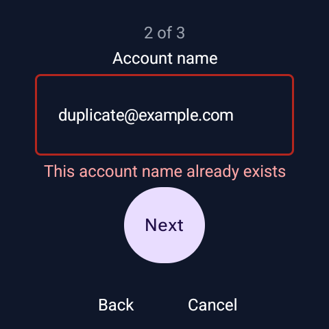
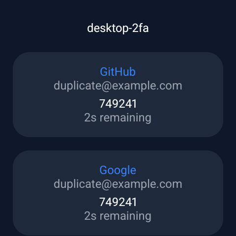
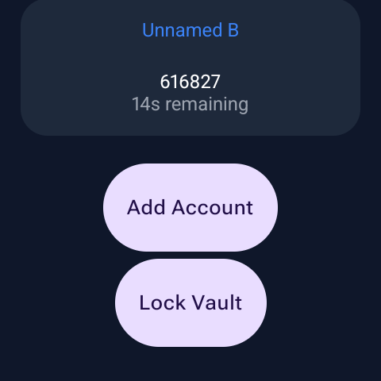

# Galaxy Watch Ultra UI Validation

Date: 2026-10-28. This is a functional device check of the unreleased issue #11
wizard, not a usability study or a security audit.

## Device and build

| Item | Value |
|------|-------|
| Device | Samsung Galaxy Watch Ultra, SM-L705F |
| OS | Android 16, API 36 |
| One UI property | `ro.build.version.oneui = 80000` |
| Display | 480 × 480 pixels |
| Keyboard | Samsung HoneyBoard; remained enabled throughout testing |
| Build | Debug APK from `feature/watch-account-wizard` with the unreleased issue #11 wizard |
| App metadata | `versionName = 0.2.0`, `versionCode = 3`; UI differs from the v0.2.0 tag |

The existing vault and preferences were preserved before synthetic fixtures
were installed. Originals were restored and checked byte-for-byte using SHA-256;
the original 30-second screen timeout was restored too. Screenshots contain
only synthetic account data. No screenshots of the original vault were taken.

## Results

| Check | Result |
|-------|--------|
| Empty vault and opening the wizard | Passed |
| One field, step indicator, and heading in the app | Passed |
| Samsung keyboard's on-screen Next/Done controls | Passed |
| Suggestions/autofill | No suggestion strip or autofill prompt observed; requested flags confirmed in EditorInfo |
| Step heading while the Samsung keyboard is open | Limitation: HoneyBoard's fullscreen editor hides the app heading and does not display the supplied hint |
| Invalid Base32 character `0` | Passed: readable error after the keyboard's native Done control |
| Back to account name | Passed: account name retained |
| Show/Hide | Passed on synthetic key input |
| Lowercase and formatting whitespace | Passed: `m y` normalized and saved as canonical `MY======` |
| Saving and success navigation | Passed: new card visible with Account added and a generated code |
| Duplicate account name | Passed: blocked on the account-name step |
| Cancel/reset | Passed: reopening starts an empty draft; no extra entry persisted |
| Existing duplicate/unnamed entries | Passed: four-entry fixture rendered and scrolled without a duplicate-key crash |
| Countdown/code changes | Observed while scrolling the synthetic account list |
| Footer actions and Lock Vault | Passed: both actions reachable; Lock Vault returns to Unlock |
| App crash log | No app crash found during the checks |

The saved file was independently decrypted with Python crypto primitives to
confirm one entry, canonical Base32 padding, and unchanged SHA1/6-digit/30-second
defaults. This is a targeted fixture check, not the full desktop round trip
planned in issue #10. Storage failures and process death during save were not
injected on this personal device.

The device screenshots also exposed dark input text in the error state. The
wizard now explicitly uses white error text and gray disabled text. The
error-state rendering was checked again on the Ultra.

## Samsung keyboard observations

HoneyBoard opens its own fullscreen editor even when the app requests no
fullscreen/extract UI and supplies a field name/hint. The wizard heading remains
visible before editing, but cannot currently be relied on while the keyboard
is open. This remains a UX limitation to evaluate with the device owner.

ADB-injected Enter is not an exact substitute for the keyboard's on-screen
action: it can advance app state while leaving the editor visible. The device
pass therefore used the actual Samsung Next/Done touch targets for the final
checks. Unlike emulator scripting, HoneyBoard was never disabled or replaced.

## Screenshots

These are unedited 480 × 480 captures. The rectangular files are the raw device
output; no artificial watch frame or circular mask was added.

| Single-field step | Samsung fullscreen keyboard |
|:-----------------:|:---------------------------:|
|  |  |

| Key validation | Duplicate-name validation |
|:--------------:|:-------------------------:|
|  |  |

| Successful save | Legacy duplicate accounts | Footer actions |
|:---------------:|:-------------------------:|:--------------:|
|  |  |  |
